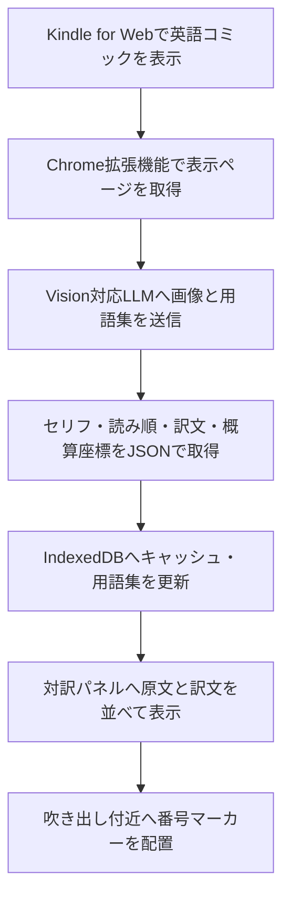

# Kindle英語コミック 日英併記翻訳Chrome拡張機能 開発メモ

## 1. プロジェクト概要

### 目的

Kindleで購入した英語コミックを、日本語訳を参照しながら英語学習にも活用できるChrome拡張機能を開発する。

英語の原文を残しつつ、自然な日本語訳を併記することで、日本語だけでもコミックとして読め、同時に英語の表現も学べるようにする。

### 対象環境

- ブラウザ：Google Chrome
- 電子書籍：Kindle for Web（Kindle Cloud Reader）
- 対象コンテンツ：英語コミック（Marvel Comicsなど）
- 開発方式：Chrome拡張機能（Manifest V3）

---

## 2. 実現したい機能

### 2.1 基本要件

- Kindleで表示しているコミックのページを取得する
- 吹き出し内の英語のセリフを認識する
- セリフの読み順を判定する
- 英語のセリフを自然な日本語に翻訳する
- 漫画の画像には一切手を加えず、原文と訳文を対訳パネルに並べて表示する
- ページをめくった際に翻訳内容を更新する

### 2.2 翻訳仕様

単語ごとの直訳ではなく、文脈を考慮した自然な日本語に翻訳する。

表示例：

```text
I HAVE TO SAVE THE WORLD!
私がこの世界を救わなきゃ！
```

翻訳時には以下を考慮する。

- 日本語として自然なセリフになること
- キャラクターの口調や感情をできるだけ維持すること
- 前後の会話や文脈を考慮すること
- 原文の意味を過度に変更しないこと
- 固有名詞の翻訳を統一すること

固有名詞の統一は、ページ単位の翻訳だけでは成立しない。作品（ASIN）ごとの用語集をIndexedDBに保持し、翻訳リクエストに毎回同梱して差分更新する。

### 2.3 表示仕様

採用方式：**漫画の外側に対訳パネルを表示し、吹き出し付近に番号マーカーを置いて対応を示す**

```text
┌─────────────────────────────────────┬───────────────────┐
│                                     │ ① I HAVE TO SAVE  │
│   ┌──────────┐                      │    THE WORLD!     │
│   │①I HAVE TO│                      │    私がこの世界を  │
│   │SAVE THE  │        ┌─────────┐   │    救わなきゃ！    │
│   │WORLD!    │        │②NOT IF I│   │                   │
│   └──────────┘        │CAN HELP │   │ ② NOT IF I CAN    │
│                       │IT!      │   │    HELP IT!       │
│      [ 漫画のページ ]  └─────────┘   │    そうはさせない！│
│                                     │                   │
└─────────────────────────────────────┴───────────────────┘
          Kindle の表示領域                  対訳パネル
```

- 対訳パネルに、読み順どおりに「番号・原文・訳文」を並べる
- 吹き出しのおおよその中心に番号マーカーを重ねる
- パネルの表示位置は右サイド／下部バーを切り替えられるようにする
- パネル全体の表示・非表示を切り替えられるようにする

#### 吹き出し内に直接描画する方式を採用しなかった理由

当初は吹き出し内に日本語訳と英語原文を上下表示する方式を検討したが、以下の理由で見送り、将来の追加表示モード（2.4）に回した。

- ピクセル精度の座標と吹き出しの**形状**検出が必要で、どちらも実現性が低い
- 英語のレタリングで既に埋まっている空間に日英2段を収める必要があり、物理的に収まらないケースが多い
- 吹き出しを塗りつぶして描き直すと原画を改変することになり、「原画に手を加えない」方針と衝突する
- 座標が数十ピクセルずれただけで「壊れている」と見えるため、要求精度がほぼ100%になる

対訳パネル方式では、必要な情報が「セリフ・読み順・概算座標」だけになり、上記のすべてが不要になる。番号マーカーの要求精度も「他の吹き出しより近い」で足りるため、数十ピクセルの誤差が許容される。

### 2.4 将来的な追加機能

- 吹き出し内に日英を直接描画する表示モード（2.3の見送り分）
- パネル行のホバーで該当エリアを半透明ハイライト
- 翻訳結果の手動修正
- 翻訳対象の吹き出しの個別指定
- キャラクターごとの口調の統一（話者推定が必要で費用対効果が低いため後回し）
- 翻訳APIの切り替え

---

## 3. 技術構成（予定）

| 分類 | 技術 | 用途 |
|---|---|---|
| Chrome拡張 | Manifest V3 | 拡張機能の基盤 |
| 言語 | TypeScript | 実装 |
| UI | React | 対訳パネル・設定画面 |
| 画面取得 | chrome.tabs.captureVisibleTab | Kindle画面の取得 |
| セリフ認識・翻訳 | Vision対応LLM（Claude Sonnet 5 / Opus 5） | 画像から「セリフ・読み順・訳文・概算座標」をJSONで取得 |
| 出力形式の固定 | 構造化出力（`output_config.format` の json_schema） | レスポンスのJSON形式を強制 |
| 表示 | HTMLオーバーレイ | 対訳パネルと番号マーカー |
| キャッシュ | IndexedDB | 翻訳結果と用語集の保存 |

※ 上記は採用候補であり、まだ最終決定していない。Phase 1の結果を踏まえて確定する。

### 3.1 Tesseract.jsを第一候補にしなかった理由

当初はTesseract.jsによるOCRを想定していたが、以下の理由から、Vision対応LLMを第一候補とする。

- アメコミには特殊フォント、全大文字、斜体、効果音、背景と重なる文字が多く、印刷文書向けのOCRでは精度が出にくい
- MV3のservice workerにはDOMがないため、`chrome.offscreen` でオフスクリーンドキュメントを立てる必要がある
- MV3はリモートコード実行が禁止されているため、wasmと `eng.traineddata`（10MB超）を拡張にバンドルする必要がある
- OCRで文字が取れても、読み順の判定と翻訳は別途必要になる

Vision対応LLMであれば、セリフ認識・読み順・翻訳を1回のリクエストで取得できるため、処理段数が減る。精度が不足する場合は、画像をクロップして読み直させるツールを与える方が、推論深度を上げるより費用対効果が高い。

### 3.2 コスト概算

1ページあたり（画像1枚 + キャッシュ済みシステムプロンプト、出力2,000トークンと仮定）：

| モデル | 画像の入力トークン | 1ページ | 100ページ | Batch API（50%引） |
|---|---|---|---|---|
| Opus 5（$5/$25） | 〜4,800 | 約 $0.074 | 約 $7.4 | 約 $3.7 |
| Sonnet 5（$3/$15） | 〜4,800 | 約 $0.044 | 約 $4.4 | 約 $2.2 |
| Haiku 4.5（$1/$5） | 〜1,600 | 約 $0.012 | 約 $1.2 | 約 $0.6 |

- あくまで概算。支配的な不確実性は出力トークン数のため、Phase 1で実測する
- Opus 5 / Sonnet 5 は長辺2576pxの高解像度画像入力に対応しており、小さなレタリングに効く。Haiku 4.5は高解像度ティア外
- 最終的な方針は「Sonnet 5で精度を見て、不足する吹き出しだけOpus 5に回す」二段構成を想定
- 1巻まるごと事前翻訳する場合はBatch API（50%引・最大24時間）が用途に合う。読む前に1巻投入してIndexedDBにキャッシュする方が、ページめくりごとのリアルタイム翻訳より安く速い

---

## 4. 処理フロー



### 処理の詳細

**Step 1：画面取得**

`chrome.tabs.captureVisibleTab()` を利用して、Kindle for Webで表示中のページを画像として取得する。

**Step 2：セリフ認識・翻訳**

取得した画像をVision対応LLMへ送信し、以下をまとめてJSONで取得する。

- 英語のセリフ
- セリフの読み順
- 自然な日本語訳
- 吹き出しの概算座標（番号マーカーの配置用）

作品ごとの用語集を同梱し、固有名詞の訳を統一する。

**Step 3：キャッシュ**

結果をIndexedDBへ保存する。キャッシュキーは以下とする。

```text
cacheKey = ASIN + ページ番号 + プロンプト/モデルのバージョン
```

画像ハッシュはウィンドウサイズ変更で壊れるため使わない。モデル/プロンプトのバージョンを含めることで、プロンプト改善時に古い訳が残り続けるのを防ぐ。

**Step 4：表示**

対訳パネルに読み順どおりに並べ、吹き出し付近に番号マーカーを置く。

マーカー配置には座標変換が必要になる。`captureVisibleTab()` が返す画像はdevicePixelRatio（とブラウザ表示倍率）が掛かった物理ピクセルだが、オーバーレイはCSSピクセルで配置するため、以下を1か所に集約して通す。

```text
scale = capturedImage.width / window.innerWidth
overlayCssX = bboxPixelX / scale
```

パネル方式では誤差が致命的にならないため、この変換の精度要求は低い。

### 4.1 パイプラインの出力形式

表示方法を差し替えられるよう、パイプラインの出力は表示に依存しない形式で固定する。

```json
{
  "page": { "asin": "B0XXXXXXX", "index": 12 },
  "balloons": [
    {
      "order": 1,
      "en": "I HAVE TO SAVE THE WORLD!",
      "ja": "私がこの世界を救わなきゃ！",
      "bbox": [120, 340, 280, 460]
    }
  ],
  "glossary_additions": [
    { "en": "Daily Bugle", "ja": "デイリー・ビューグル" }
  ]
}
```

- `bbox` はパネル方式では番号マーカーの配置にしか使わないが、将来の吹き出し内表示モードのために必ず取得しておく。追加コストはほぼゼロ
- 構造化出力のJSON Schemaは `minimum` / `maximum` / `minLength` などの数値・文字列制約をサポートしないため、`bbox` の値域チェックはクライアント側で実装する

---

## 5. 現在の進捗

### 実施済み

- [x] 実現したい機能を整理
- [x] Kindleでの翻訳方式を検討
- [x] 対訳パネル + 番号マーカー方式を採用（吹き出し内描画は将来モードに見送り）
- [x] Chrome拡張機能の基本構成を検討
- [x] Manifest V3の検証用拡張機能を作成
- [x] Kindle for Webでの画面キャプチャを実施
- [x] 漫画のページが正常にキャプチャできることを確認

### 現時点で確認できていること

**Kindle for Webで表示している英語コミックの画面を、Chrome拡張機能からPNG画像として取得できた。**

これにより、セリフ認識処理へ渡すための画像取得経路は確保できた。

ただし、Kindle上へのオーバーレイ表示や自動ページ切り替えへの追従は未検証。

### 未実施

- [ ] 評価用の正解データ作成（10ページ分の手打ち書き起こし）
- [ ] Vision対応LLMによるセリフ認識・読み順・翻訳の精度検証
- [ ] 認識精度の数値評価
- [ ] 対訳パネルのオーバーレイ表示
- [ ] 番号マーカーの配置と座標変換
- [ ] ページ切り替えの検出
- [ ] 翻訳結果のキャッシュ
- [ ] 作品ごとの用語集の構築

---

## 6. 作成済みの検証用Chrome拡張機能

> 注：以下のコードはこのドキュメント内にのみ存在し、リポジトリにはまだファイルとして存在しない。Phase 1で `kindle-capture-test/` として実際にコミットし、ここからはリンクに置き換える。

### ディレクトリ構成

```text
kindle-capture-test/
├── manifest.json
└── background.js
```

### manifest.json

```json
{
  "manifest_version": 3,
  "name": "Kindle Capture Test",
  "version": "1.0.0",
  "description": "Kindle画面のキャプチャ可否を確認",
  "permissions": [
    "activeTab",
    "downloads"
  ],
  "action": {
    "default_title": "Kindle画面をキャプチャ"
  },
  "background": {
    "service_worker": "background.js"
  }
}
```

### background.js

```javascript
chrome.action.onClicked.addListener(async (tab) => {
  try {
    const dataUrl = await chrome.tabs.captureVisibleTab(
      tab.windowId,
      { format: "png" }
    );

    await chrome.downloads.download({
      url: dataUrl,
      filename: "kindle-capture-test.png",
      saveAs: true
    });

    console.log("キャプチャ成功");
  } catch (error) {
    console.error("キャプチャ失敗:", error);
  }
});
```

### 検証手順

1. Chromeで `chrome://extensions` を開く
2. デベロッパーモードを有効化する
3. 検証用拡張機能を読み込む
4. Kindle for Webで英語コミックを開く
5. Chrome拡張機能のアイコンをクリックする
6. PNGファイルを保存する
7. 漫画の画像と英語のセリフが正常に取得できているか確認する

**検証結果：成功**

### 本番で必要になるpermissions

検証用とは構成が変わるため、実装時に以下へ更新する。

- `storage`（APIキー・設定・用語集）
- `scripting`（オーバーレイの注入）
- `host_permissions`：`https://read.amazon.co.jp/*` に加えて `https://read.amazon.com/*` など対象ドメイン、および翻訳APIのエンドポイント
- `downloads` は不要になる

---

## 7. 今後の開発計画

### Phase 1：セリフ認識・翻訳の実現性検証（次に実施）

目的：取得したコミック画像から、セリフ・読み順・訳文をどの程度の精度で取得できるか確認する。

実装内容：

- 評価用の正解データを作成する（10ページ・吹き出し100個の手打ち書き起こし）
- 検証用拡張機能を `kindle-capture-test/` としてリポジトリにコミットする
- キャプチャ画像をVision対応LLMへ送信する
- 構造化出力でJSONを固定し、セリフ・読み順・訳文・概算座標を取得する
- 正解データと比較して精度を数値で評価する
- 1ページあたりの実トークン数とコストを実測する
- `effort` を low / medium / high でスイープし、精度とコストの釣り合いを確認する

完了条件：

- 文字単位のCERが10%未満
- 「手直し不要」と判定できる吹き出しが80%以上
- 吹き出し単位の取りこぼし（未検出）が10%以下
- 読み順が正しいページが80%以上
- 1ページあたりのコストが許容範囲内であること

この段階では画面へのオーバーレイ表示は実装しない。精度とコストの実現性を確認し、その結果を踏まえてモデルと表示方式を確定する。

### Phase 2：対訳パネル表示

目的：キャプチャから対訳パネル表示までを一通りつなぐ。

実装内容：

- Kindleの表示領域のDOM構造を調査する（コミック画像がcanvas / img / iframeのどれでレンダリングされているか、ページ送りでDOMが作り直されるか）
- 対訳パネルをHTMLオーバーレイとして実装する
- 読み順どおりに原文と訳文を並べる
- パネルの表示位置（右サイド／下部バー）と表示・非表示を切り替えられるようにする
- ワイドモニタのレターボックス領域にパネルを置けるか確認する（漫画を隠さずに済む）

この段階で「実際に読める」状態になる。

### Phase 3：番号マーカー

目的：パネルの行と吹き出しの対応を示す。

実装内容：

- 概算座標から番号マーカーを配置する
- devicePixelRatio・ブラウザ表示倍率を通した座標変換を実装する
- 拡大縮小・スクロールへの追従を実装する

Phase 2だけで読んでみて、対応が分からず不便だと判断した場合に実施する。

### Phase 4：自動化・使いやすさの改善

目的：ページをめくるだけで翻訳された状態で読めるようにする。

実装内容：

- ページ切り替えの検出
- 翻訳結果のキャッシュ（IndexedDB）
- 作品ごとの用語集の構築と差分更新
- Batch APIによる1巻単位の事前翻訳
- エラー処理・処理中の表示

---

## 8. 技術的な課題

### セリフ認識の精度

アメコミには特殊なフォント、全大文字、斜体、効果音、背景と重なる文字などがある。

Vision対応LLMで十分な精度が得られない場合は、以下を検討する。

- 画像をクロップして読み直させるツールを与える（推論深度を上げるより費用対効果が高い）
- 上位モデル（Opus 5）へのフォールバック
- 低精度の吹き出しのみ手動修正できるUI

**これがプロジェクト唯一の本質的なリスクであり、Phase 1でここを通せば全体の実現性がほぼ確定する。**

### APIキーの扱い

- API呼び出しは必ずservice workerから行う。content scriptから呼ぶとキーがページコンテキストに露出し、Kindleのページ側JSから読める
- 保存は `chrome.storage.local`。`storage.sync` は端末間に秘密情報が伝播するため使わない
- ソースにハードコードしない

### ページ切り替えの検出

パネル方式では、座標ずれによる表示崩れは起きないため、吹き出し内描画方式ほど厳密な追従は不要。ただし古い訳が残り続けないよう、ページ送りの検出は必要になる。

Kindleの表示領域のDOM構造に依存するため、Phase 2の調査結果を踏まえて方式を決める。

### Kindleのコンテンツ保護

今回の画面キャプチャは成功しているが、すべての作品や端末で同様に動作するとは限らない。

DRMの解除やコンテンツ保護の回避は行わず、通常の表示・取得が許される範囲で実装する。

翻訳済み画像などの再配布は行わず、個人での読書・学習用途を想定する。

※ 拡張機能そのものを公開（Chrome Web Store への掲載）するかは別論点として未決定。

---

## 9. 参考資料

- [Kindle for Web](https://read.amazon.co.jp/)
- [chrome.tabs API](https://developer.chrome.com/docs/extensions/reference/api/tabs)
- [chrome.scripting API](https://developer.chrome.com/docs/extensions/reference/api/scripting)
- [chrome.offscreen API](https://developer.chrome.com/docs/extensions/reference/api/offscreen)
- [Claude API - Vision](https://platform.claude.com/docs/en/build-with-claude/vision)
- [Claude API - Structured outputs](https://platform.claude.com/docs/en/build-with-claude/structured-outputs)
- [Claude API - Batch processing](https://platform.claude.com/docs/en/build-with-claude/batch-processing)
- [Tesseract.js](https://github.com/naptha/tesseract.js)（第一候補から外したが、ローカル処理が必要になった場合の候補）
- [Panora Chrome Extension](https://github.com/PanoraTL/extension)
- [Kindle Cloud Reader Translate](https://github.com/motiko/kcr-translate-ext)

---

## 10. 次に実施する作業

**最優先：評価用の正解データ作成と、セリフ認識・翻訳の精度検証**

```text
10ページ分の正解データを手打ちで作成
    ↓
Kindleの画面をキャプチャ
    ↓
Vision対応LLMへ画像を送信（構造化出力でJSON固定）
    ↓
セリフ・読み順・訳文・概算座標を取得
    ↓
正解データと比較して精度を数値評価
    ↓
実トークン数とコストを実測
```

この段階では画面への表示は実装しない。

まず精度とコストの実現性を確認し、その結果を踏まえてモデルを確定する。

---

**現在のステータス：画面キャプチャ検証完了、表示方式の決定済み、認識精度の検証着手前**
