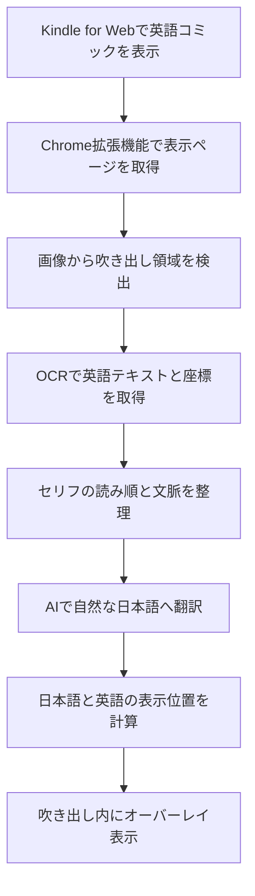

# Kindle英語コミック 日英併記翻訳Chrome拡張機能 開発メモ

## 1. プロジェクト概要

### 目的

Kindleで購入した英語コミックを、日本語訳を参照しながら英語学習にも活用できるChrome拡張機能を開発する。

英語の原文を残しつつ、自然な日本語訳を吹き出し内に追加することで、日本語だけでもコミックとして読め、同時に英語の表現も学べるようにする。

### 対象環境

- ブラウザ：Google Chrome
- 電子書籍：Kindle for Web（Kindle Cloud Reader）
- 対象コンテンツ：英語コミック（Marvel Comicsなど）
- 開発方式：Chrome拡張機能（Manifest V3）

---

## 2. 実現したい機能

### 2.1 基本要件

- Kindleで表示しているコミックのページを取得する
- 吹き出し内の英語のセリフをOCRで認識する
- 英語のセリフを自然な日本語に翻訳する
- 原文を消さずに、日本語訳と英語原文を上下に表示する
- 漫画の絵や吹き出しの形を可能な限り維持する
- ページをめくった際に翻訳内容を更新する

### 2.2 翻訳仕様

単語ごとの直訳ではなく、文脈を考慮した自然な日本語に翻訳する。

表示例：

```text
私はその世界を救わなければいけない！
I have to save the world!
```

翻訳時には以下を考慮する。

- 日本語として自然なセリフになること
- キャラクターの口調や感情をできるだけ維持すること
- 前後の会話や文脈を考慮すること
- 原文の意味を過度に変更しないこと
- 固有名詞の翻訳を統一すること

### 2.3 表示仕様

採用方式：**吹き出し内に日本語訳と英語原文を上下表示する**

漫画の外側に対訳パネルを表示する方式ではなく、吹き出し内に直接翻訳を追加する。

- 上段：日本語訳
- 下段：英語原文
- 翻訳のON/OFF切り替え
- 吹き出しのサイズに応じた文字サイズ調整
- 文字が収まらない場合の表示方法を検討

### 2.4 将来的な追加機能

- ページ切り替え時の自動翻訳
- 翻訳済みページのキャッシュ
- 翻訳対象の吹き出しの個別指定
- 日本語訳の表示・非表示切り替え
- 翻訳結果の手動修正
- キャラクターごとの口調の統一
- 翻訳APIの切り替え

---

## 3. 技術構成（予定）

| 分類 | 技術 | 用途 |
|---|---|---|
| Chrome拡張 | Manifest V3 | 拡張機能の基盤 |
| 言語 | TypeScript | 実装 |
| UI | React | 設定画面・操作UI |
| 画面取得 | chrome.tabs.captureVisibleTab | Kindle画面の取得 |
| OCR | Tesseract.js | 画像から英語を抽出 |
| 吹き出し検出 | 画像認識モデルなど | セリフ領域の特定 |
| 翻訳 | OpenAI API / Gemini API | 自然な日本語への翻訳 |
| 翻訳表示 | SVG / Canvas | 日英テキストの重ね合わせ |
| キャッシュ | IndexedDB | 翻訳結果の保存 |

※ 上記は採用候補であり、まだ最終決定していない。

---

## 4. 処理フロー



### 処理の詳細

**Step 1：画面取得**

`chrome.tabs.captureVisibleTab()` を利用して、Kindle for Webで表示中のページを画像として取得する。

**Step 2：吹き出し検出・OCR**

取得した画像から以下の情報を抽出する。

- 英語のセリフ
- テキストの座標
- セリフの領域
- 吹き出しの領域
- セリフの読み順

**Step 3：翻訳**

認識した英語を、前後の文脈を考慮しながら自然な日本語へ翻訳する。

**Step 4：オーバーレイ表示**

取得した座標情報をもとに、Kindleの表示領域へ日本語訳と英語原文を重ねる。

元の吹き出し内に収まらない場合は、文字サイズやレイアウトを調整する。

---

## 5. 現在の進捗

### 実施済み

- [x] 実現したい機能を整理
- [x] Kindleでの翻訳方式を検討
- [x] 吹き出し内への日英併記方式を採用
- [x] Chrome拡張機能の基本構成を検討
- [x] Manifest V3の検証用拡張機能を作成
- [x] Kindle for Webでの画面キャプチャを実施
- [x] 漫画のページが正常にキャプチャできることを確認

### 現時点で確認できていること

**Kindle for Webで表示している英語コミックの画面を、Chrome拡張機能からPNG画像として取得できた。**

これにより、OCR処理へ渡すための画像取得経路は確保できた。

ただし、Kindle上へのオーバーレイ表示や自動ページ切り替えへの追従は未検証。

### 未実施

- [ ] OCRライブラリの導入
- [ ] 英語テキストの抽出
- [ ] テキスト座標の取得
- [ ] 吹き出し領域の検出
- [ ] OCR精度の検証
- [ ] 翻訳APIとの連携
- [ ] 日英併記のオーバーレイ表示
- [ ] Kindle上での位置合わせ
- [ ] ページ切り替えの検出
- [ ] 翻訳結果のキャッシュ

---

## 6. 作成済みの検証用Chrome拡張機能

### ディレクトリ構成

```text
kindle-capture-test/
├── manifest.json
└── background.js
```

### manifest.json

```json
{
  "manifest_version": 3,
  "name": "Kindle Capture Test",
  "version": "1.0.0",
  "description": "Kindle画面のキャプチャ可否を確認",
  "permissions": [
    "activeTab",
    "downloads"
  ],
  "action": {
    "default_title": "Kindle画面をキャプチャ"
  },
  "background": {
    "service_worker": "background.js"
  }
}
```

### background.js

```javascript
chrome.action.onClicked.addListener(async (tab) => {
  try {
    const dataUrl = await chrome.tabs.captureVisibleTab(
      tab.windowId,
      { format: "png" }
    );

    await chrome.downloads.download({
      url: dataUrl,
      filename: "kindle-capture-test.png",
      saveAs: true
    });

    console.log("キャプチャ成功");
  } catch (error) {
    console.error("キャプチャ失敗:", error);
  }
});
```

### 検証手順

1. Chromeで `chrome://extensions` を開く
2. デベロッパーモードを有効化する
3. 検証用拡張機能を読み込む
4. Kindle for Webで英語コミックを開く
5. Chrome拡張機能のアイコンをクリックする
6. PNGファイルを保存する
7. 漫画の画像と英語のセリフが正常に取得できているか確認する

**検証結果：成功**

---

## 7. 今後の開発計画

### Phase 1：OCR検証（次に実施）

目的：取得したコミック画像から英語のセリフを抽出できるか確認する。

実装内容：

- Tesseract.jsを導入する
- キャプチャ画像をOCRに渡す
- 認識した英語を出力する
- 認識した文字の座標情報を取得する
- 認識精度を評価する

完了条件：

- 英語のセリフが一定の精度で取得できる
- テキスト領域の座標が取得できる

### Phase 2：吹き出し検出

目的：英語のセリフと対応する吹き出しの領域を特定する。

実装内容：

- 吹き出し領域を検出する
- OCR結果を吹き出しごとに分類する
- 漫画の読み順を判定する

### Phase 3：AI翻訳

目的：英語のセリフを日本語として自然な文章に翻訳する。

実装内容：

- OpenAI APIまたはGemini APIと連携する
- セリフ単位で翻訳する
- 前後の文脈を考慮する
- 翻訳結果と原文の対応関係を保持する

### Phase 4：日英併記表示

目的：Kindleの吹き出し内に日本語訳と英語原文を上下表示する。

実装内容：

- SVGまたはHTMLオーバーレイを実装する
- 吹き出し内の表示位置を計算する
- 翻訳文と原文を上下に配置する
- フォントサイズを調整する
- Kindleの拡大縮小に対応する

### Phase 5：自動化・使いやすさの改善

目的：ページをめくるだけで翻訳されたコミックを読めるようにする。

実装内容：

- ページ切り替え検出
- 自動OCR・翻訳
- 翻訳結果のキャッシュ
- 翻訳ON/OFF切り替え
- エラー処理・処理中の表示

---

## 8. 技術的な課題

### OCR精度

アメコミには特殊なフォント、斜体、効果音、背景と重なる文字などがある。

Tesseract.jsで十分な精度が得られない場合は、別のOCRやVisionモデルを検討する。

### 吹き出しの領域検出

OCRで文字の位置が取得できても、吹き出し全体の形状が取得できるとは限らない。

吹き出し検出用の画像認識処理が必要になる可能性がある。

### 日英テキストの表示領域

日本語訳と英語原文の両方を表示するには、元の吹き出し内のスペースが不足する可能性がある。

以下の方法を検討する。

- フォントサイズの自動調整
- 改行位置の最適化
- 翻訳の省略を避けながら自然な短文にする
- 表示しきれない場合の拡大表示

### Kindleへの表示

画面キャプチャには成功しているが、Kindleの表示領域にオーバーレイを正確に配置できるかは未検証。

Canvasなどの描画方式、ページの拡大縮小、スクロール、ブラウザの表示倍率への対応が必要。

### Kindleのコンテンツ保護

今回の画面キャプチャは成功しているが、すべての作品や端末で同様に動作するとは限らない。

DRMの解除やコンテンツ保護の回避は行わず、通常の表示・取得が許される範囲で実装する。

翻訳済み画像などの再配布は行わず、個人での読書・学習用途を想定する。

---

## 9. 参考資料

- [Kindle for Web](https://read.amazon.co.jp/)
- [Chrome Extensions API](https://developer.chrome.com/docs/extensions/reference/api/tabs)
- [Tesseract.js](https://github.com/naptha/tesseract.js)
- [Panora Chrome Extension](https://github.com/PanoraTL/extension)
- [Kindle Cloud Reader Translate](https://github.com/motiko/kcr-translate-ext)

---

## 10. 次に実施する作業

**最優先：OCRによる英語セリフの抽出と座標取得**

次回は、現在の検証用Chrome拡張機能を拡張して、以下の処理を実装する。

```text
Kindleの画面をキャプチャ
    ↓
Tesseract.jsでOCR
    ↓
英語のセリフを抽出
    ↓
テキストと座標を取得
    ↓
認識結果を一覧表示
```

この段階では、翻訳や画面への重ね合わせは実装しない。

まず英語の認識精度と座標取得の実現性を確認し、その結果を踏まえて翻訳・描画方式を決定する。

---

**現在のステータス：画面キャプチャ検証完了、OCR検証着手前**
